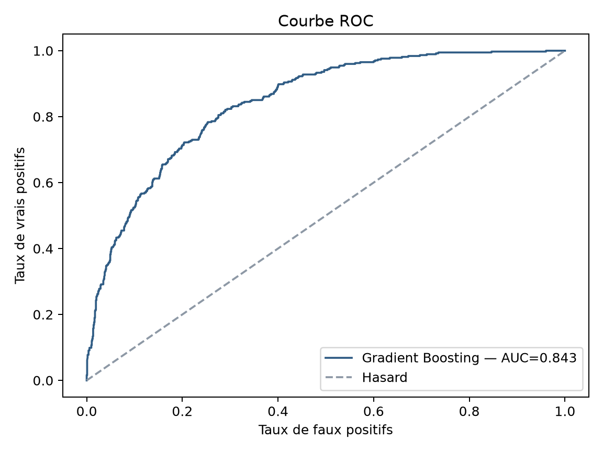
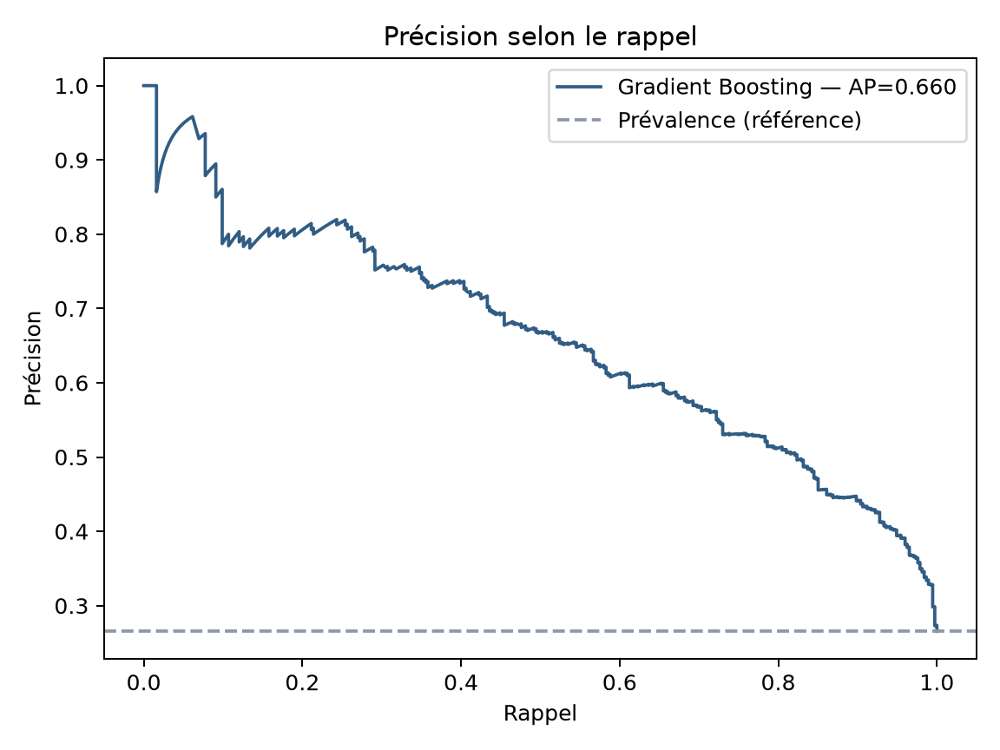
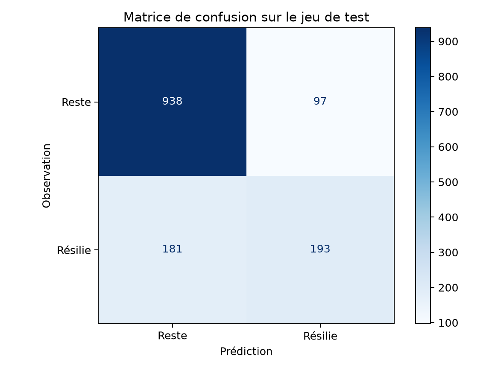
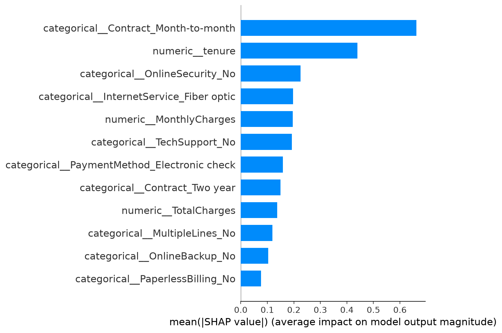

# ChurnScope

Projet personnel de data science : prédire la résiliation (churn) de clients d'un opérateur télécom et identifier les facteurs associés, afin de prioriser des actions de rétention.

**Auteure :** Ilicia Benaoudia

[Short project overview in English](PROJECT_OVERVIEW_EN.md)

## Données

Jeu de données public **IBM Telco Customer Churn** : 7 043 clients, 21 variables (abonnement, services, contrat, facturation). La cible est `Churn` (`Yes` / `No`), avec environ 26,5 % de clients qui résilient.

Le fichier n'est pas versionné. Télécharge-le et place-le dans `data/raw/` :

```powershell
curl.exe -L -o data/raw/Telco-Customer-Churn.csv https://raw.githubusercontent.com/IBM/telco-customer-churn-on-icp4d/master/data/Telco-Customer-Churn.csv
```

Sur Linux/macOS, remplacez `curl.exe` par `curl`.

## Démarche

1. Audit des 21 colonnes : types, modalités, valeurs nulles et chaînes vides, identifiants, montants négatifs et cohérence entre services. Les 11 valeurs vides de `TotalCharges` concernent toutes des clients d'ancienneté nulle : elles sont mises à 0. L'audit complet est dans [`reports/DATA_AUDIT.md`](reports/DATA_AUDIT.md).
2. Analyse exploratoire : churn selon le contrat, le service Internet, l'ancienneté, le moyen de paiement et le montant mensuel (voir `notebooks/01_exploration.ipynb`).
3. Séparation stratifiée : 80 % des clients pour l'entraînement, 20 % gardés à part pour le test final. `customerID` est retiré des variables prédictives.
4. Comparaison de trois modèles par validation croisée stratifiée à 5 plis **sur l'entraînement seulement** : régression logistique, Random Forest, Gradient Boosting. La standardisation et l'encodage one-hot sont dans le pipeline, donc réappris dans chaque pli.
5. Choix du modèle selon la moyenne du ROC-AUC en validation, puis entraînement sur les 80 % et évaluation une seule fois sur le test : accuracy, precision, recall, F1, ROC-AUC et average precision (AP).
6. Comparaison avec une référence qui prédit toujours « reste ». Analyse des erreurs par segment et illustration du compromis entre seuil, précision et rappel ; aucun nouveau seuil n'est choisi sur le test. Interprétation par importance par permutation et valeurs SHAP ; tableau de bord Dash sur les clients du jeu de test.

Les classes étant déséquilibrées (73,5 % / 26,5 %), l'accuracy seule est trompeuse : le recall et la precision sont suivis en parallèle.

L'audit n'a trouvé aucun identifiant en double ni valeur numérique négative. Il relève 22 profils identiques si l'on ignore `customerID` : ils sont conservés, car rien ne prouve qu'il s'agit de la même personne.

## Résultats

| Modèle | ROC-AUC moyen en validation | Écart-type entre plis |
| --- | ---: | ---: |
| Régression logistique | 0,8460 | 0,0124 |
| Random Forest | 0,8417 | 0,0085 |
| Gradient Boosting | 0,8481 | 0,0126 |

Le Gradient Boosting a la moyenne la plus élevée, mais l'écart avec la régression logistique est petit. Ce tableau ne suffit pas à conclure qu'il sera toujours meilleur sur de nouvelles données.

| Évaluation finale (test, 1 409 clients) | Accuracy | Precision | Recall | F1 | ROC-AUC | AP |
| --- | ---: | ---: | ---: | ---: | ---: | ---: |
| Gradient Boosting | 0,803 | 0,666 | 0,516 | 0,581 | 0,843 | 0,660 |
| Référence « reste » | 0,735 | 0 | 0 | 0 | 0,500 | 0,265 |

Au seuil de 0,5, le modèle repère environ 52 % des clients qui résilient. Pour une vraie campagne de rétention, il faudrait choisir le seuil selon le coût des offres envoyées et celui des résiliations manquées. La forte accuracy de la référence (73,5 %) montre pourquoi cette métrique ne suffit pas.

Sur le test, la matrice de confusion compte **193 départs détectés, 181 manqués, 97 fausses alertes et 938 clients correctement classés comme restant**. Les [erreurs par segment](reports/error_analysis.csv) montrent notamment que les 45 départs observés parmi les contrats d'un ou deux ans ne sont pas détectés au seuil de 0,5. Ce résultat décrit ce test précis ; il ne faut pas le généraliser sans autre validation.

Une [comparaison descriptive des seuils](reports/threshold_analysis.csv) montre qu'à 0,3 le rappel monte à 0,751, mais les fausses alertes passent de 97 à 249. Il ne s'agit pas d'un seuil « optimal » : le choisir sur le test rendrait l'évaluation trop optimiste.

Principaux constats de l'analyse exploratoire (associations, pas causalité) :

- le churn est bien plus élevé pour les contrats mensuels (42,7 %) que pour les contrats d'un an (11,3 %) ou de deux ans (2,8 %) ;
- les clients en fibre optique résilient davantage (41,9 %) ;
- les clients qui partent ont une ancienneté plus faible.
- le paiement par chèque électronique est associé à un taux de churn de 45,3 % ; le montant mensuel médian est plus élevé chez les clients qui partent (79,65 contre 64,43).

| Courbe ROC | Courbe précision-rappel |
| --- | --- |
|  |  |

| Matrice de confusion | Importance SHAP |
| --- | --- |
|  |  |

Les autres graphiques d'exploration (contrat, Internet, ancienneté, paiement, montant mensuel) sont dans `reports/figures/`.

## Limites et pistes d'amélioration

- Validation croisée pour choisir le modèle, mais un seul jeu de test final : pas d'intervalle de confiance sur les performances futures.
- Hyperparamètres fixés à l'avance, sans recherche systématique.
- Seuil de décision fixé à 0,5 ; il devrait être calibré selon le coût d'une action de rétention par rapport à la valeur d'un client conservé.
- Jeu de données public et statique : pas de dimension temporelle ni de suivi en production.
- Le dashboard présente les résultats sur le jeu de test ; il ne permet pas de scorer un nouveau client.

## Installation et exécution

Testé avec Python 3.11.

```powershell
python -m venv .venv
.\.venv\Scripts\Activate.ps1
python -m pip install -r requirements.txt
python src/train.py
python app.py
```

Sur Linux/macOS, l'activation de l'environnement est `source .venv/bin/activate`. Pour revoir l'exploration, lancez Jupyter depuis la racine du projet avec `jupyter notebook`, puis ouvrez `notebooks/01_exploration.ipynb`.

L'entraînement génère les métriques et figures (`reports/`), le modèle local (`reports/best_model.joblib`) et les scores du jeu de test (`data/processed/`). Le dashboard est ensuite accessible sur http://127.0.0.1:8050/. Il faut lancer l'entraînement avant le dashboard, car les données brutes et les scores ne sont pas versionnés.

Les contrôles automatiques se lancent avec `python -m unittest discover -s tests -v`. Ils vérifient notamment le traitement de `TotalCharges`, les doublons d'identifiants, les catégories et services incohérents, l'exclusion de l'identifiant et la gestion d'une catégorie inconnue par le pipeline.

## Structure

```
app.py                 dashboard Dash
assets/style.css       style du dashboard
src/train.py           validation croisée, entraînement, test final, interprétation
notebooks/             exploration des données
reports/               audit, métriques, erreurs, figures, synthèse ; modèle local non versionné
data/                  données brutes et prédictions (non versionnées)
tests/                 contrôles automatiques de préparation
```

Source des données : IBM.
